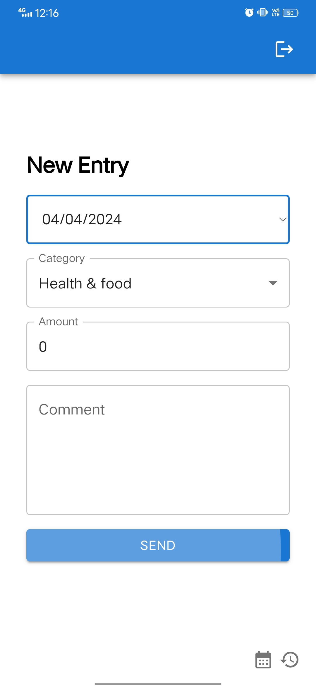

Note: Backend code is old and not used. It is there maybe to use sometime in future.

# Expensy


It is an expense manager that takes data from your personalized google spread sheet and loads into the Expensy application.

## Features

1. Add new expense.
2. Delete expense.
3. View Monthly expense
4. Visualize monthly expense using charts

## Getting started

**Prerequisites**

1. You need to have a google project created which has access to your google client ID.
2. Spreadsheet Schema. Refer [this](./docs/spreadsheet-schema.md).

### Setup environment variables

In ui package, create `.env` file and put your client ID there in `VITE_CLIENT_ID` variable.

### Build UI

Run the following script to build UI.

```
cd ui
npm run build
```

It should do all the things.

You are good to go.
